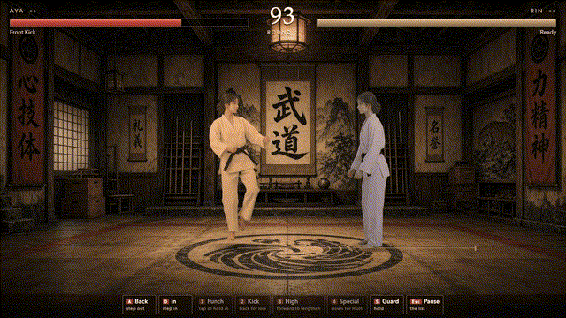

# VibeCool Fighter (Karate)

A karate fighting game created with Grok. Fighters are generated from green-screen punch-kicking videos using Grok Imagine. Chroma key removes each backdrop so the fighters stand on a dojo image. The project was vibe-coded with Grok through multiple iterative rounds of refinement.

## Play the Game

You can run the game directly in your browser (no download required):

- **Revised Version**: [https://micre13b.com/projects/karate/index.html](https://micre13b.com/projects/karate/index.html)
- **Original Version**: [https://micre13b.com/projects/karate/index_org.html](https://micre13b.com/projects/karate/index_org.html)

## Preview

## How It Was Made

- Green-screen punch and kick videos generated with **Grok Imagine**
- Chroma key compositing to place the fighters on a dojo background
- Iterative vibe-coding and refinement with Grok

---

*Open source — feel free to explore and build on it.*
